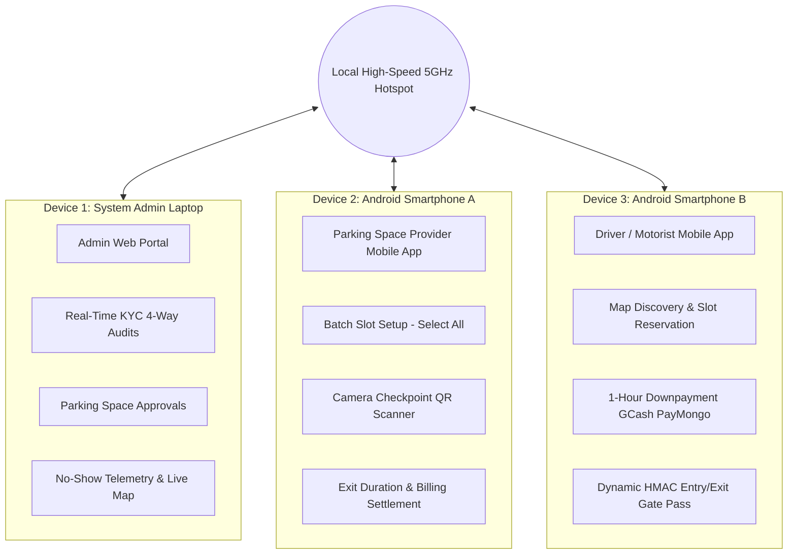

# E-Parada: Capstone 3 Three-Device Live Demonstration Runbook

**Project:** *E-Parada: A Digital Marketplace for Parking Spaces*  
**Document Type:** Technical Setup Guide, Network Topology & Live Defense Execution Protocol  
**Proponents:** Bustria, Christian Jake C. | Gamad, Leticia C. | Ovilla, Shan Jenis C. | Valiña, Resha Lorraine P.  
**Institution:** College of Engineering and Architecture, National University (NU) Laguna  
**Scope:** Three-Device Live Interactive Demonstration for Capstone 3 Final Defense  

---

## 1. System Topology & Device Allocation

To provide conclusive proof of distributed real-time synchronization, the Capstone 3 defense must be executed across **three dedicated physical devices**:



### Device Inventory & Responsibilities
| Hardware Unit | Assigned Actor | Application & Surface | Key Demonstration Actions |
| :--- | :--- | :--- | :--- |
| **Device 1: Laptop** (External Projector/Monitor) | Shan Jenis C. Ovilla (Admin) | Laravel 12 Admin Web Portal (Chrome / Edge) | Live KYC document audit, vehicle/space approvals, dispute management, no-show monitoring. |
| **Device 2: Android Phone A** | Resha Lorraine P. Valiña (Provider) | Flutter Mobile App (Owner Mode) | Batch slot configuration, live camera QR scanning of gate passes, checkout settlement. |
| **Device 3: Android Phone B** | Christian Jake C. Bustria (Driver) | Flutter Mobile App (Driver Mode) | Searching spaces on Google Maps, paying 1-hr downpayment, displaying dynamic QR gate pass. |

---

## 2. Zero-Downtime Local Network Setup Protocol

> [!CAUTION]
> **NEVER RELY ON INSTITUTIONAL OR DEFENSE ROOM PUBLIC WI-FI.**  
> Public university Wi-Fi networks typically enforce **AP Client Isolation** (which strictly blocks direct peer-to-peer communication between your laptop and mobile phones) or have strict firewalls blocking port 8000.

### Step 1: Create a Dedicated 5GHz Mobile Hotspot
1. On a mobile phone with stable mobile data (LTE/5G), enable **Personal Hotspot**.
2. Configure Hotspot Settings:
   - **AP Band:** 5 GHz Band (preferred for lower latency and zero packet collision).
   - **Network Name (SSID):** `EParada-Defense-Net`
   - **Security:** WPA2-Personal with a simple known password.
3. Connect **Device 1 (Laptop)**, **Device 2 (Phone A)**, and **Device 3 (Phone B)** to `EParada-Defense-Net`.

### Step 2: Determine Laptop Local IPv4 Address
On the Laptop (Device 1), open PowerShell and run:
```powershell
ipconfig
```
Locate the **Wireless LAN adapter Wi-Fi** section and note the **IPv4 Address** (e.g., `192.168.43.150` or `192.168.137.1`). Let this address be `<HOST_IP>`.

### Step 3: Open Windows Firewall for Port 8000
Run PowerShell as Administrator on the Laptop to permit incoming traffic from Android devices:
```powershell
New-NetFirewallRule -DisplayName "Laravel Dev Server Port 8000" -Direction Inbound -LocalPort 8000 -Protocol TCP -Action Allow
```

### Step 4: Configure Backend `.env` File
In `c:\Users\kimch\e-parada\.env`, set the application host to your LAN IP:
```ini
APP_URL=http://<HOST_IP>:8000
SANCTUM_STATEFUL_DOMAINS=<HOST_IP>:8000
SESSION_DOMAIN=<HOST_IP>
```

### Step 5: Launch Backend Server with 0.0.0.0 Binding
Start the Laravel development server listening on all network interfaces:
```powershell
cd c:\Users\kimch\e-parada
php artisan serve --host=0.0.0.0 --port=8000
```
*Verify on phone browser:* Open `http://<HOST_IP>:8000` on Phone A's Chrome browser. If the login screen loads, network connectivity is 100% verified.

### Step 6: Configure Flutter Mobile App Endpoint
In `c:\Users\kimch\e_parada_mobile\lib\config\api_config.dart` (or `api_service.dart`):
```dart
// Point both mobile apps to the host laptop's local IP
static const String baseUrl = 'http://<HOST_IP>:8000/api';
```
Build/run the Flutter apps on both physical Android devices:
```powershell
cd c:\Users\kimch\e_parada_mobile
flutter run -d <DEVICE_A_ID>
flutter run -d <DEVICE_B_ID>
```

---

## 3. Pre-Defense Calibration Checklist (T-Minus 15 Minutes)

Execute this sequence 15 minutes before calling the panel to order:

- [ ] **1. Fresh Database Seeding with Authentic Philippine Data:**
  ```powershell
  cd c:\Users\kimch\e-parada
  php artisan migrate:fresh --seed
  ```
  *Result:* Restores all verified Philippine demo accounts, vehicles, Calamba parking spaces, and sample reservations.
- [ ] **2. Pre-Authenticate Accounts on All Devices:**
  - **Device 1 (Laptop):** Log in as Admin (`admin@eparada.ph` / `password`).
  - **Device 2 (Phone A):** Log in as Parking Provider (`owner@eparada.ph` / `password`).
  - **Device 3 (Phone B):** Log in as Driver (`driver@eparada.ph` / `password`).
  *(Avoid typing credentials in front of the panel to prevent typos and save presentation time).*
- [ ] **3. Display & Sleep Settings:**
  - Set Screen Timeout on Phone A and Phone B to **10 minutes** or **Never (while charging)**.
  - Set screen brightness to 80% for high visibility under defense room lighting.
  - Disable "Do Not Disturb" notifications to prevent incoming personal messages during the demo.
- [ ] **4. Camera & Location Permissions:**
  - Open Checkpoint Scanner on Phone A and confirm camera preview initializes smoothly.
  - Open Map on Phone B and confirm GPS location permission is granted.

---

## 4. Minute-by-Minute Live Defense Runbook

Follow this precise choreography during the live demonstration segment:

```
┌────────────────────────────────────────────────────────────────────────┐
│ TIMELINE: 5-MINUTE LIVE DEMONSTRATION CHOREOGRAPHY                     │
└────────────────────────────────────────────────────────────────────────┘

[00:00 - 01:00] INTRO & ADMIN TWO-FACTOR KYC (Device 1: Laptop)
  • Presenter 1 introduces the 3-device live synchronization setup.
  • On Laptop: Display the Admin 4-Way Document Inspection Grid.
  • Show side-by-side comparison:
    - Vehicle Plate Photo vs. OCR Plate Match.
    - Official LTO OR/CR documents.
    - Calamba Barangay Clearance and Government ID.
  • Click [Approve Vehicle] and [Approve Space] in real-time.

[01:00 - 02:00] SPACE PROVIDER BATCH CONFIGURATION (Device 2: Phone A)
  • Presenter 2 holds Phone A up to the panel (or mirrors to external display).
  • Show adding a space with 12 slots.
  • Highlight the panel revision: Tap "Select All Slots" -> Select "All = Car/SUV".
  • Demonstrate that all 12 slots are instantly configured in a single tap without manual fatigue.

[02:00 - 03:00] DRIVER BOOKING & 1-HOUR DOWNPAYMENT (Device 3: Phone B)
  • Presenter 3 opens Driver App on Phone B.
  • Browse map in Calamba City, select "SM City Calamba Carpark", pick Slot 01.
  • Highlight the 1-Hour Downpayment notice dialog (₱45.00).
  • Tap [Pay via GCash (PayMongo)].
  • Complete PayMongo test transaction.
  • Show instant status transition to "Approved" and the emergence of the high-contrast Entry QR Gate Pass.

[03:00 - 04:00] THE PHYSICAL TWO-WAY QR HANDSHAKE (Device 2 <-> Device 3)
  • In full view of the panel, bring Phone A (Provider) and Phone B (Driver) together.
  • Aim Phone A's camera at Phone B's Entry QR Pass.
  • Beep / Haptic confirmation triggers in < 400ms!
  • Phone A flashes green: "CHECK-IN SUCCESS: Toyota Fortuner (NBI 9999) - Slot 01".
  • Phone B's screen automatically transitions to "Currently Parked" with live duration timer.
  • Point to Device 1 (Laptop): Show that the Admin dashboard synchronized the check-in instantaneously.

[04:00 - 05:00] EXIT SETTLEMENT & DOWNPAYMENT DEDUCTION (Device 2: Phone A)
  • Aim Phone A's scanner at Phone B's Exit Pass.
  • Dialog opens showing the Exit Billing Breakdown:
    - Gross Computed Duration (e.g., 2 Hours = ₱90.00).
    - Less 1-Hour Downpayment: -₱45.00 (in emerald green).
    - Net Balance Due: ₱45.00.
  • Provider taps [Confirm Cash Received].
  • Driver on Phone B instantly receives digital receipt and 5-star rating feedback sheet.
```

---

## 5. Fail-Safe Contingency Matrix

If any hardware or network anomaly occurs during the defense, execute these pre-tested fallback procedures immediately:

| Potential Failure Point | Root Cause | Immediate Backup Action |
| :--- | :--- | :--- |
| **Camera Scanner Fails to Read QR** | Harsh glare or low phone backlight. | 1. Increase brightness on Phone B.<br>2. Tap **"Enter Pass Code Manually"** on Phone A and type the 6-character backup code: `GATE1001`. |
| **Local IP Changes Unexpectedly** | Hotspot disconnected and reconnected. | Run `ipconfig`, update `baseUrl` in `api_config.dart`, and execute hot-restart (`R` in Flutter terminal). |
| **PayMongo Sandbox Latency** | Third-party payment gateway downtime. | Use the built-in **"Simulate GCash Webhook"** bypass button in the reservation dialog to instantly verify downpayment locally. |
| **Driver Phone Loses Battery** | Hardware discharge. | Keep an external powerbank connected to Phone B throughout the presentation. |

---
*Protocol approved for E-Parada Capstone 3 Final Defense | NU Laguna College of Engineering and Architecture*
